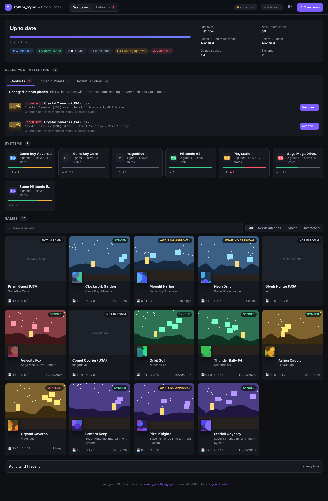
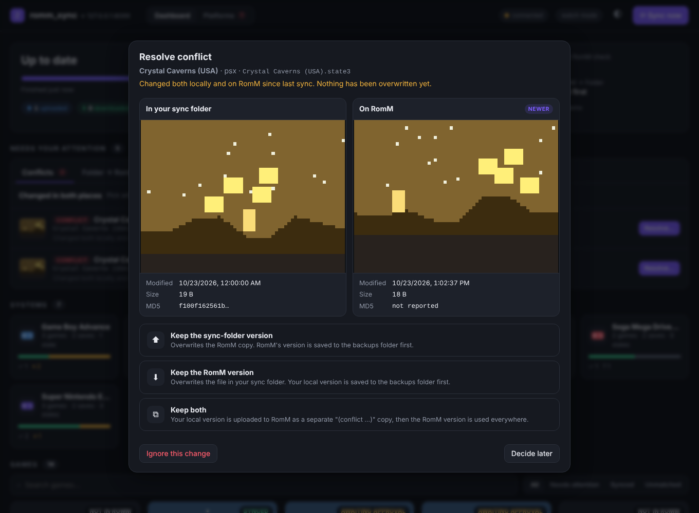
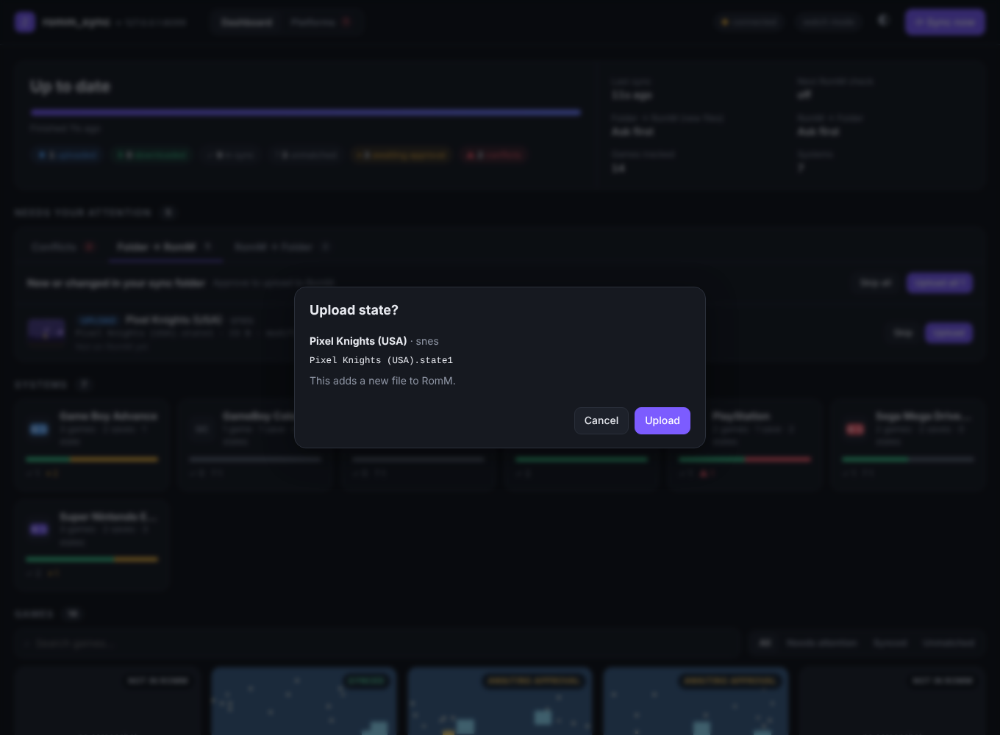
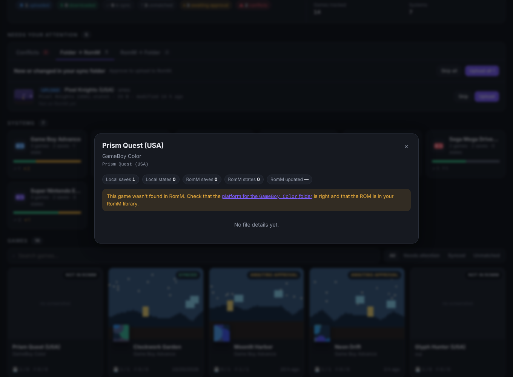
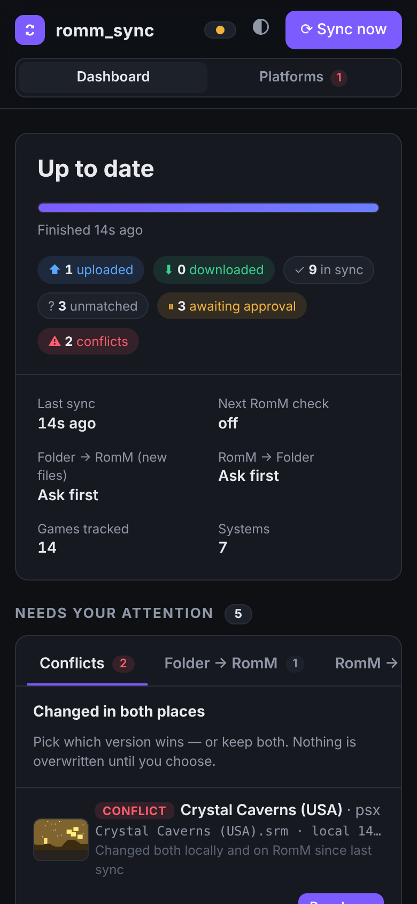
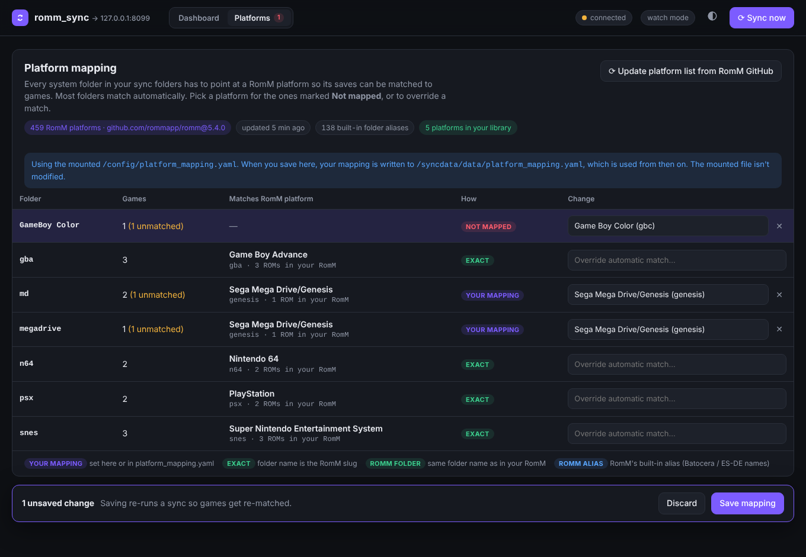

# romm_sync — with web dashboard & two-way sync

A utility for syncing emulator save files and save states across your gaming devices and [RomM](https://romm.app/), now with a web dashboard and sync in both directions.

> **This is a fork.** The original **[romm_syncthing_sync](https://github.com/amn-96/romm_syncthing_sync)** was created by **[amn-96](https://github.com/amn-96)** and is MIT licensed. All the core sync logic, RomM matching and platform mapping are their work. This fork adds a web GUI, RomM → folder sync, approvals and conflict handling. See [NOTICE.md](NOTICE.md) for exactly what changed.

<picture>
  <source media="(prefers-color-scheme: light)" srcset="docs/screenshots/dashboard-light.png">
  
</picture>

## What's new in this fork

- **Web dashboard** on port `8080`:
  - live sync progress
  - every system with a status bar
  - every game with its RomM cover art and the latest save-state screenshot (from RomM, or RetroArch's local `.png`)
  - an activity log
- **RomM → folder sync.** Saves and states that are new or newer on RomM (from another device, the web player, Grout…) can be written back into your Syncthing folder. Syncthing then delivers them to your handhelds.
- **Approvals.** By default nothing new crosses in either direction until you click **Upload** / **Download** in the dashboard. A confirmation box shows exactly what will happen. You can also switch either direction to fully automatic.
- **Conflict handling.** If a file changed on *both* sides since the last sync, nothing is overwritten. The dashboard shows the two versions side by side (time, size, hash, screenshot) and you choose:
  - **keep the folder version**
  - **keep the RomM version**
  - **keep both** (your local copy is stored on RomM as a separate `(conflict …)` entry)
- **Backups.** Before any file is overwritten (on either side), the version being replaced is copied to `/data/backups/<date>/<system>/`.
- **Platforms page** to map your system folders to RomM platforms. It uses RomM's official platform list and folder aliases, fetched from RomM's GitHub.
- **Unraid template** with the web UI link, icon and all settings.
- **Automatic releases.** Every change pushed to the default branch is tested, tagged, released and published as a Docker image.

| Conflict resolution | Confirmation box | Game details |
|---|---|---|
|  |  |  |

<details><summary>Phone layout</summary>


</details>

*(Screenshots use invented demo games and generated artwork from the bundled mock RomM server.)*

# Overview

*From the original author, amn-96:*

I've found that Romm is a nice way to have a "source of truth" for my game library, but for now, full-featured clients like [Grout](https://github.com/rommapp/grout) are not supported for all handhelds and Romm's planned sync feature is not ready (yet). If you have multiple handhelds whose saves are kept in sync with syncthing and want a way to have those in RomM so you can switch back and forth at will, **romm_sync** might help!

This all started when I set up Syncthing between my devices with Retroarch-based OS's (Android, MuOS, Knulli,...) and Minarch-based OS's (MinUI, NextUI) and none of the folders lined up properly and forced me into making a tedious Syncthing folder setup. Doable yes, but annoying. I had my Romm instance sitting right there and an opportunity to practice my Python for work so now...here we are.

## What you'll need
- A server or NAS (e.g. Unraid) that hosts a central file sync location. Syncthing works well, but technically it could be anything.
- A self hosted instance of RomM that is accessible from the machine this app runs on. RomM 4.5+ works; **5.x is recommended** (content hashes make change detection more precise).
- Docker to deploy the app.

## How it works
1. Gaming devices sync save files to a central location via Syncthing.
2. `romm_sync` detects new/modified saves and states in this "local library".
3. It matches the contents of your library with the content on your RomM instance.
4. For each save/state it compares both sides against what they looked like at the last sync, and then either syncs it, asks you, or flags a conflict.

```
Gaming Devices (RetroArch, etc.)
         ↕ (Syncthing)
    Central Sync Folder  ←──────────────┐
         ↕ (romm_sync watches + polls)  │ approvals / conflicts
    RomM (via API)                      │
         ↕                              │
    Web dashboard :8080 ────────────────┘
```

### What gets synced automatically and what asks first

| Situation | Default | Setting |
|---|---|---|
| A file you already synced changed **only locally** | Uploaded automatically (original behaviour) | — |
| A **new** local file RomM has never seen | Asks first | `PUSH_NEW_MODE=confirm\|auto` |
| A file is **new or newer on RomM** | Asks first | `PULL_MODE=confirm\|auto\|off` |
| A file changed **on both sides** | Always asks: conflict | `FORCE_PUSH_SYNC=true` makes local always win |
| A file was **deleted** on one side | Asks first, never automatic | — |

If you skip an item, you won't be asked about it again until one of the two copies changes.

**Upgrading from the original romm_sync:** the first time this version sees a file on both sides, there is no sync history to compare against yet. It falls back to the original rule: if the local copy is newer it gets uploaded, otherwise it is assumed to be in sync. On RomM 5.x, saves carry a content hash, so a save that really differs and is newer on RomM is offered for download instead. No false conflicts are raised on the first run.

## Some caveats

### Limited scope of save support
*(original author)* I wrote this mainly for my uses, so it's probably not taking everybody possible folder structure into account. My Retroarch instance is configured similar to the Knulli defaults, so it should cover common usage patterns.

- Sort Saves by Content Directory
- Sort States by Content Directory

### Possible incompatibilities
It *does not* sort states by core, though I had some leftover different cores for Nintendo DS that seemed to work ok. This will work best with save (.srm) files, and, if you're consistent in the cores you use, .state files should "just work" as well.

The implicit assumption here is that the game files (ROM, with one M) on your device are *already* the same files as the ROMs in your RomM library. Set up your RomM library before trying to run this app. RomM allows you to map your *local* directory names to *their supported platform names* ("slugs") to make library management easier. [See the docs here.](https://docs.romm.app/latest/Getting-Started/Configuration-File/?h=platform+name#custom-folder-names)

### Downloads land next to the files your devices already use
Files pulled from RomM are written into the same `<sync folder>/<system folder>/` layout, named the way RetroArch expects (`Game (USA).srm`, `Game (USA).state1` + `.state1.png`). RomM-only games are placed in an existing system folder that maps to the game's RomM platform. If you have no folder for that system yet, create it (or add it to `platform_mapping.yaml`).

### Still not a full RomM client
This doesn't download ROMs or manage your library. For devices that can run a real RomM client (e.g. Grout), that's still the better choice. This tool is for the devices that can't.

# Install

## Unraid

1. Add the template. Open the Unraid terminal (**>_** in the top bar) and run:
   ```bash
   wget -O /boot/config/plugins/dockerMan/templates-user/my-romm-sync.xml \
     https://raw.githubusercontent.com/sireteanu/romm_syncthing_sync/HEAD/unraid/romm-sync.xml
   ```
2. Go to **Docker → Add Container**, pick **romm-sync** from the **Template** dropdown, and fill in:
   - **Saves folder** / **States folder**: your Syncthing folders, e.g. `/mnt/user/syncthing/saves`
   - **App data**: `/mnt/user/appdata/romm-sync`
   - **RomM URL** and **RomM API token**
3. *(Optional)* Download [`platform_mapping.yaml`](platform_mapping.yaml) into `/mnt/user/appdata/romm-sync/`. You can also skip it and map folders on the dashboard's **Platforms** page.
4. **Apply**, then click the container icon → **WebUI**.

If your saves and states live in **one** folder: switch to **Advanced View**, remove the States folder path and the `SAVE_SYNC_FOLDER` / `STATE_SYNC_FOLDER` variables, change the Saves folder's container path to `/syncdata`, and add a variable `ALL_SYNC_FOLDER` = `/syncdata`.

## Docker Compose

Download `docker-compose.yml`, `.env.example` and `platform_mapping.yaml` to a folder, edit `.env.example` (see below), then:

```bash
docker compose up -d
```

Open `http://<server>:8080`.

> The sync folders are now mounted **read-write** so RomM → folder sync can work. If you only ever want folder → RomM, add `:ro` back to those mounts and set `PULL_MODE=off`.

## Configure

All settings are environment variables (`.env.example`, or the Unraid template).

### RomM

**`ROMM_URL`** (required): your RomM instance's address.

**`ROMM_AUTH_TYPE`** (required): `api` (recommended) or `http`. "api" lets publicly hosted RomM instances stay locked behind OIDC.

**`ROMM_API_TOKEN`** (required for api auth): in RomM, click your profile image → **Client API Tokens** → Create. The token needs read access to ROMs and platforms and **read + write for saves/states (assets)**. The original author's limited set below works. It can't write to the ROM library, collections or users:


**`ROMM_USERNAME` / `ROMM_PASSWORD`** (required for http auth).

**`ROMM_API_LIMIT`** (optional): page size when reading the RomM library. Default 50.

### Sync folders

#### Single sync folder
All saves and states sorted by content directory in one parent folder (Knulli-style):
```
{SYNC_FOLDER}/
├── Nintendo 64/
│   ├── Game Name.srm
│   ├── Game Name.state
│   └── Game Name.state.png
└── Game Boy Advance/
    ├── Another Game.srm
    └── Another Game.state
```
Use only **`ALL_SYNC_FOLDER`**.

#### Separate save and state parents
*(original author)* This is the way I do it because CFWs like MuOS and MinUI/NextUI put their saves and states in completely different places, but still sort by content directory.
```
{SAVE_SYNC_FOLDER}/            {STATE_SYNC_FOLDER}/
├── Nintendo 64/               ├── Nintendo 64/
│   └── Game Name.srm          │   ├── Game Name.state
└── Game Boy Advance/          │   └── Game Name.state.png
    └── Another Game.srm       └── Game Boy Advance/
                                   └── Another Game.state
```
Use **`SAVE_SYNC_FOLDER`** and **`STATE_SYNC_FOLDER`**.

### Sync mode

**`SYNC_MODE`**:
- `watch` (default): full sync on start, then incremental syncs on file changes. RomM is also re-checked every `ROMM_POLL_INTERVAL_SECONDS`, because changes made on RomM don't create local file events.
- `periodic`: full sync every `SYNC_INTERVAL_SECONDS`.

A full sync now fetches all saves and states in two API calls instead of two per game, so it's quick even for large libraries.

| Variable | Default | |
|---|---|---|
| `WATCHDOG_DELAY_SECONDS` | 60 | watch: quiet time after file activity before syncing |
| `ROMM_POLL_INTERVAL_SECONDS` | 600 | watch: how often to check RomM for changes. `0` = only when you click **Sync now** |
| `SYNC_INTERVAL_SECONDS` | 1800 | periodic: seconds between full syncs |
| `FULL_INITIAL_SYNC` | true | `true`, `false`, or `force` (force-push once on startup) |
| `FORCE_PUSH_SYNC` | false | local always wins, even over conflicts. Dangerous |

### Two-way sync & approvals

| Variable | Default | |
|---|---|---|
| `PUSH_NEW_MODE` | confirm | new local files → RomM: `confirm` or `auto` |
| `PULL_MODE` | confirm | RomM → folder: `confirm`, `auto` or `off` |
| `BACKUP_RETENTION_DAYS` | 30 | keep backups of overwritten files this long (`0` = forever) |
| `DATA_FOLDER` → `/data` | `./data` | sync history, pending approvals, backups. **Keep this persistent**, it's how changes on each side are told apart |
| `PUID` / `PGID` | — | owner of files written into the sync folders (Unraid: `99` / `100`) |

### Web UI

| Variable | Default | |
|---|---|---|
| `WEB_UI` | true | turn the dashboard off with `false` |
| `WEB_HOST_PORT` | 8080 | host port (compose) |
| `WEB_USERNAME` / `WEB_PASSWORD` | empty | optional basic auth for the dashboard |

The dashboard has no other login. Don't expose it to the internet without a password or a reverse proxy with auth.

### Platform mapping

Each system folder in your sync folders (`snes`, `md`, `Nintendo 64`, …) has to point at a RomM platform so its saves can be matched to games. Open the **Platforms** tab in the dashboard to see how every folder resolves and fix the ones that don't:



Folders are resolved in this order, and most never need a mapping:

1. **Your mapping**: chosen on the Platforms page (or in `platform_mapping.yaml`)
2. **Exact**: the folder name is a RomM platform slug (`snes`, `gba`, `n64`…)
3. **RomM folder**: the folder has the same name as that platform's folder in *your* RomM library
4. **RomM alias**: one of RomM's built-in folder aliases for Batocera / RetroBat / ES-DE names (`megadrive`, `amstradcpc`, `atarilynx`…)

**Where the platform list comes from:** the full list of platforms RomM supports (459 at the time of writing) and RomM's folder aliases are downloaded from GitHub. Slugs and aliases come from [`rommapp/romm`](https://github.com/rommapp/romm), fetched at the tag that matches your RomM server's version when that tag exists, with display names from [`rommapp/docs`](https://github.com/rommapp/docs). The list is cached in `/data/romm_platforms.json` and refreshed weekly, or whenever you click **Update platform list from RomM GitHub**. If GitHub can't be reached, the cached list is used. In the picker, platforms that are already in your RomM library are listed first.

**The mapping file:** saving on the Platforms page writes `/data/platform_mapping.yaml`. If you also mount a `platform_mapping.yaml` (the original setup), it's used until you first save in the UI. After that it's only the starting point and is never modified. The format is unchanged:
```yaml
genesis:        # RomM platform slug
  - md          # your folder names (case-insensitive)
  - megadrive
```
The bundled [`platform_mapping.yaml`](platform_mapping.yaml) (from the original project) covers common MinUI/NextUI and Knulli folder names. With the Platforms page it's optional.

See https://docs.romm.app/latest/Platforms-and-Players/Supported-Platforms/ for RomM's supported platforms.

# Releases

Every push to the default branch (`public`) creates a release automatically ([`.github/workflows/release.yml`](.github/workflows/release.yml)):
1. tests run;
2. the version is `VERSION` if that tag doesn't exist yet, otherwise the patch number is bumped (2.0.0 → 2.0.1 → …);
3. a git tag and GitHub release with generated notes are created;
4. `ghcr.io/sireteanu/romm_syncthing_sync:{version}`, `:{major.minor}` and `:latest` are published (amd64 + arm64).

Bump `VERSION` for a new minor/major. Add `[skip release]` to a commit message to push without releasing.

# Developing

```bash
pip install -r requirements.txt pillow
python -m pytest tests                 # decision-rule unit tests
python -m tests.mock_romm --port 8099  # fake RomM 5.4 API with demo games
python -m tests.demo_setup /tmp/demo   # matching demo sync folders
```
The app reads its folders from fixed container paths (`/syncdata/saves`, `/syncdata/states`, `/config/platform_mapping.yaml`). To run it outside Docker, create those paths (or symlinks to `/tmp/demo/...`) and start it with:
```bash
ROMM_URL=http://127.0.0.1:8099 ROMM_AUTH_TYPE=api ROMM_API_TOKEN=x \
SAVE_SYNC_FOLDER=1 STATE_SYNC_FOLDER=1 PLATFORM_MAP_FILE=1 DATA_DIR=/tmp/demo/data \
SYNC_MODE=watch python romm_sync.py
```

See [docs/TWO_WAY_SYNC.md](docs/TWO_WAY_SYNC.md) for how the sync engine decides what to do, and [docs/IMPLEMENTATION_SUMMARY.md](docs/IMPLEMENTATION_SUMMARY.md) for the original architecture write-up.

# Known issues

- Game names are matched by exact file name against RomM's `fs_name`, as in the original. Saves named differently from the ROM won't match.
- RomM 5.x saves uploaded by other clients into *slots* get a version tag in their name (`Game [2026-10-01 …].srm`). The tag is stripped when writing to the sync folder, and the newest version wins.
- ~~Retroarch's state screenshots are not linked to the corresponding state file on the RomM server.~~ Fixed in RomM.
- ~~Only HTTP Basic Authentication.~~ API tokens supported since 1.4.0.
- ~~Syncthing only PUSHES to RomM.~~ RomM → folder sync added in 2.0.0.

# Credits & license

- Original project: **[romm_syncthing_sync](https://github.com/amn-96/romm_syncthing_sync) by [amn-96](https://github.com/amn-96)**. Thank you!
- Fork changes: [sireteanu](https://github.com/sireteanu).
- [RomM](https://github.com/rommapp/romm) by the RomM team. This project only uses its public API.

MIT License. See [LICENSE](LICENSE) (original copyright retained) and [NOTICE.md](NOTICE.md).
